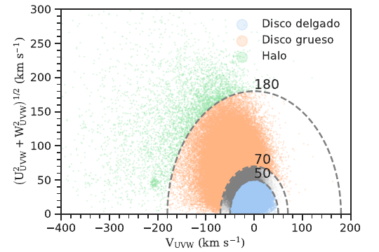
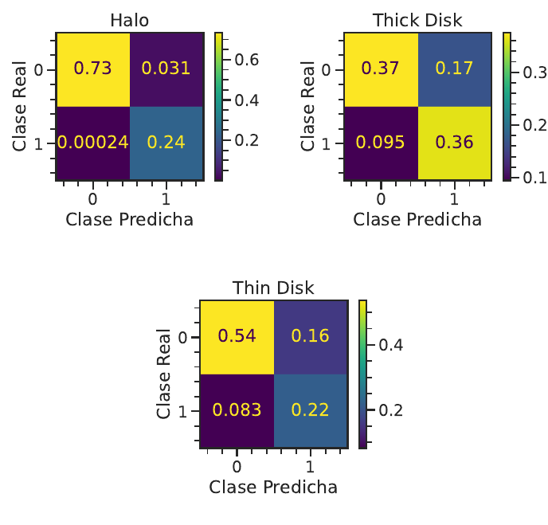
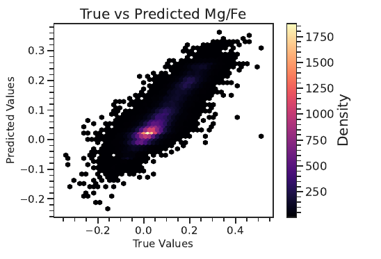
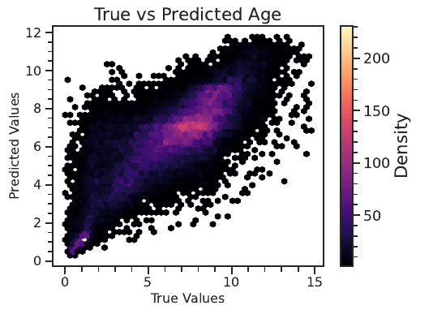
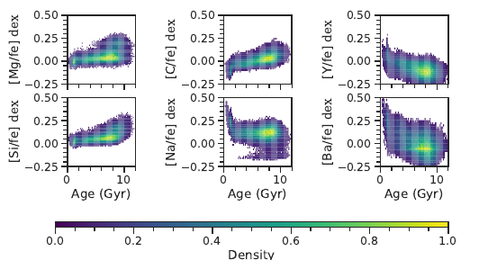

# GALAH DR4 · Random Forest para la Vía Láctea

Clasificación de componentes galácticas, predicción de abundancias químicas ([Mg/Fe]) y estimación de edades estelares con **Random Forest**, usando más de 900 000 estrellas del *Data Release 4* de GALAH.

 

<p align="center">
  
</p>

## Resumen

Las abundancias químicas conservan la huella del medio en que se formó una estrella. Este proyecto pregunta cuánta información sobre la estructura y la historia de la Vía Láctea puede recuperarse **solo a partir de datos espectroscópicos**, mediante tres experimentos:

1. **Clasificación de componentes** (halo, disco delgado, disco grueso): etiquetas cinemáticas obtenidas con el diagrama de Toomre y un Random Forest binario por componente.
2. **Predicción de [Mg/Fe]**: regresión con el resto de abundancias y parámetros estelares (sin los otros elementos α).
3. **Relojes químicos**: estimación de la edad estelar usando únicamente abundancias [X/Fe].

Luego se comprueba que lo que el modelo "aprendió" es coherente con la física conocida: abundancia de elementos α en el disco grueso, correlación entre [Mg/Fe] y metalicidad, y tendencias opuestas de [Mg/Fe] (crece con la edad) e [Y/Fe] (decrece con la edad).

El detalle completo está en el informe: [`reports/informe_galah_random_forest.pdf`](reports/informe_galah_random_forest.pdf).

## Resultados principales

Valores reportados en el informe (los de clasificación se calculan a partir de las matrices de confusión normalizadas):

| Experimento | Métrica optimizada | Resultado |
|---|---|---|
| Halo (clasificación) | Recall | ≈ 0,999 |
| Disco delgado (clasificación) | Accuracy | ≈ 0,76 |
| Disco grueso (clasificación) | Accuracy | ≈ 0,73 |
| [Mg/Fe] (regresión) | R² | 0,78 |
| Edad estelar (regresión) | R² | 0,62 |

Variables más importantes para clasificar cada componente:

| Componente | 1.º | 2.º | 3.º |
|---|---|---|---|
| Halo | [Ti/Fe] | [Si/Fe] | [Fe/H] |
| Disco delgado | [Fe/H] | [Ti/Fe] | [Mg/Fe] |
| Disco grueso | [Si/Fe] | [Mg/Fe] | [Ti/Fe] |

<p align="center">
  
  
</p>
<p align="center">
  
  
</p>

## Metodología

- **Datos:** catálogos de GALAH DR4 (*allstar*, abundancias de Li 3D-NLTE, dinámica y cruce con WISE/2MASS/Gaia DR3), unidos por `sobject_id`.
- **Calidad:** `snr_px_ccd3 > 30`, `flag_sp = 0`; se descartan las abundancias con más de 15 % de NaN y se conservan solo las estrellas con `flag_X_fe = 0` en todas las abundancias seleccionadas.
- **Outliers:** *sigma clipping* a 5σ sobre las columnas usadas en cada modelo.
- **Etiquetas cinemáticas:** velocidad total `V_tot = √(U² + V² + W²)`. Disco delgado `< 50 km/s`; disco grueso `70–180 km/s`; halo `> 180 km/s`. La zona 50–70 km/s (traslape) se excluye del entrenamiento.
- **Desbalance de clases:** el halo es ~2 % de la muestra; se sobremuestrea duplicando sus estrellas y se usa `class_weight="balanced"`. Por eso, en el halo la métrica clave es el *recall*.
- **Modelos:** `RandomForestClassifier` / `RandomForestRegressor` de scikit-learn; los hiperparámetros (profundidad, nº de árboles, `min_samples_split`, `min_samples_leaf`) se exploran variando uno a la vez.
- **Relojes químicos:** estrellas con `Teff < 6200 K` y `−1,0 < [Fe/H] < 0,5`, siguiendo a Hayden et al. (2022).

## Estructura del repositorio

```
.
├── configs/config.yaml        # rutas, umbrales, hiperparámetros y barridos
├── data/
│   ├── raw/                   # catálogos FITS de GALAH DR4 (no incluidos)
│   └── processed/             # ready_data.csv (generado)
├── src/galah_ml/
│   ├── config.py              # carga de configuración
│   ├── data_loading.py        # lectura de FITS y unión de catálogos
│   ├── preprocessing.py       # calidad, etiquetas de Toomre, outliers, balanceo
│   ├── models.py              # Random Forest, métricas, barridos de hiperparámetros
│   ├── plotting.py            # figuras
│   └── pipeline.py            # flujos completos de cada experimento
├── scripts/
│   ├── 01_build_catalog.py
│   ├── 02_classify_components.py
│   ├── 03_predict_mg_fe.py
│   └── 04_predict_age.py
├── tests/                     # pruebas con datos sintéticos
├── figures/                   # figuras generadas; figures/report/ = figuras del informe
├── results/                   # métricas (JSON) e importancias (CSV) generadas
└── reports/                   # informe en PDF
```

## Instalación

```bash
git clone https://github.com/pablo-dz/galah-dr4-random-forest.git
cd galah-dr4-random-forest

# Crear y activar el entorno virtual (Python 3.11+)
python3.11 -m venv .venv && source .venv/bin/activate

# En Windows:
# py -3.11 -m venv .venv
#.venv\Scripts\activate

# Instalar el proyecto
python -m pip install --upgrade pip
pip install -e .
```

Opcional: `pip install -e ".[plots]"` para usar el estilo `science` de SciencePlots, y `pip install -e ".[dev]"` para las pruebas.

## Datos

Los catálogos no se incluyen por su tamaño. Descárgalos desde la página de GALAH DR4 ([galah-survey.org](https://www.galah-survey.org)) y déjalos en `data/raw/` con estos nombres (ver [`data/README.md`](data/README.md)):

- `galah_dr4_allstar_240705.fits`
- `galah_dr4_vac_3dnlte_a_li_240705.fits`
- `galah_dr4_vac_dynamics_240705.fits`
- `galah_dr4_vac_wise_tmass_gaiadr3_240705.fits`

## Uso

```bash
python scripts/01_build_catalog.py          # genera data/processed/ready_data.csv
python scripts/02_classify_components.py    # Toomre + 3 clasificadores
python scripts/03_predict_mg_fe.py          # regresión de [Mg/Fe]
python scripts/04_predict_age.py            # relojes químicos
```

Cada script de modelado acepta `--sweeps` para ejecutar también los barridos de hiperparámetros (lento) y `--config` para usar otro archivo de configuración. Las figuras se guardan en `figures/` y las métricas en `results/`. También hay un `Makefile` (`make catalog`, `make all`, `make test`).

## Reproducibilidad

- Las divisiones entrenamiento/prueba y los bosques usan una **semilla fija** (`random_seed` en `configs/config.yaml`). El informe usó particiones aleatorias sin semilla, por lo que las métricas al reproducir pueden diferir levemente.
- Por defecto se replica el procedimiento del informe: el sobremuestreo del halo se hace **antes** de dividir en entrenamiento y prueba. Con `classification.balance.after_split: true` se divide primero y se sobremuestrea solo el entrenamiento, evitando copias idénticas entre ambos conjuntos.
- Pruebas: `pytest` (usan datos sintéticos y no requieren los catálogos de GALAH).

## Referencias principales

- Buder et al. 2024, *The GALAH Survey: Data Release 4*, [arXiv:2409.19858](https://arxiv.org/abs/2409.19858)
- Hayden et al. 2022, MNRAS, 517, 5325 (relojes químicos con GALAH)
- Da Silva et al. 2023, ApJ, 958, 32 (clasificación cinemática y química del disco)
- Shejeelammal et al. 2024, A&A, 690, A107

La lista completa está en el informe.

## Autor

**Pablo Díaz Arancibia** · Licenciado en Astronomía, Pontificia Universidad Católica de Chile  
[LinkedIn](https://linkedin.com/in/paaldz) · [GitHub](https://github.com/pablo-dz) · paaldz02@gmail.com

## Licencia

[MIT](LICENSE)
